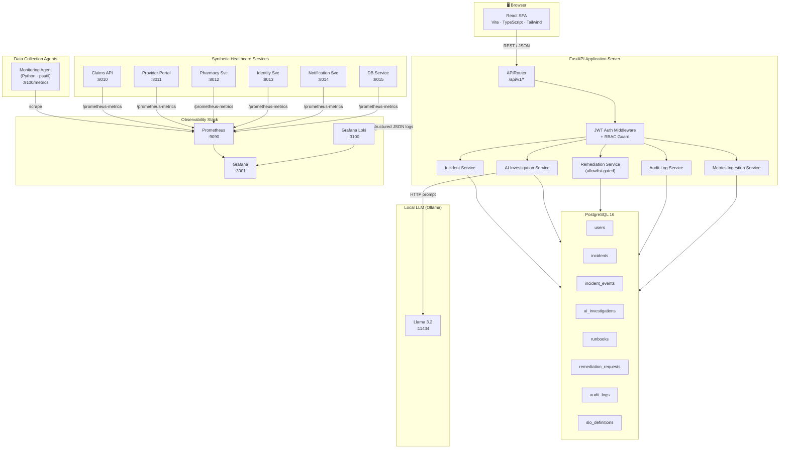
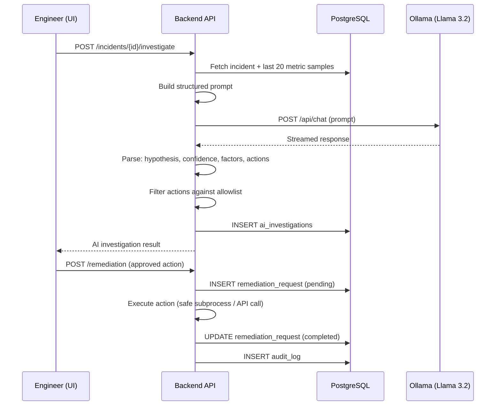

# HealthTechOps — Architecture

## Overview

HealthTechOps is designed as a loosely-coupled, service-oriented application where each subsystem has a single clear responsibility. The system is fully containerised with Docker Compose for local development and can be deployed to any container orchestration platform.

---

## Full Architecture Diagram



---

## Component Descriptions

### Frontend (React SPA)
- **Framework**: React 19 + TypeScript + Vite 8
- **Styling**: Tailwind CSS v4 with Claude-inspired design tokens (cream canvas, coral accents)
- **State**: Zustand (auth + theme) + TanStack Query (server state)
- **Charts**: Recharts for time-series metric visualisations

### Backend (FastAPI)
- **Framework**: FastAPI 0.115 on Python 3.11
- **ORM**: SQLAlchemy 2.0 (SQLite for local dev, PostgreSQL for production)
- **Migrations**: Alembic with autogenerate
- **Auth**: python-jose for JWT signing, passlib/bcrypt for password hashing with RBAC guards
- **Validation**: Pydantic v2 for all request/response schemas

### Monitoring Agent
A standalone Python script (`monitoring/agent.py`) that:
1. Collects host metrics (CPU, memory, disk, network) via `psutil` every 15 seconds
2. Exposes them as Prometheus-format metrics on `:9100/metrics`
3. Regularly monitors synthetic healthcare services on ports 8010-8015

### Synthetic Services
Six Flask micro-applications simulating realistic healthcare service behaviour:
- Configurable latency (normal distribution) and error rates
- `/health`, `/metrics`, `/logs`, `/prometheus-metrics`, and `/inject-failure` endpoints on each port
- `simulator.py` launches all six concurrently with reentrant thread safety (`RLock`)

### AI Investigation Engine
When an incident is escalated to AI, the backend:
1. Collects the last N metric samples for affected services
2. Builds a structured prompt with incident context, metric anomalies, and system topology
3. Sends the prompt to Ollama (Llama 3.2) via HTTP
4. Parses the response to extract: root cause hypothesis, confidence score, contributing factors, recommended actions
5. Stores the structured result in `ai_investigations` table
6. All recommended actions are cross-referenced against the remediation allowlist before being surfaced to the user

### Remediation Allowlist Engine
Prevents unconstrained AI-driven actions:
- `ALLOWED_REMEDIATION_ACTIONS` is a hardcoded list of safe operations (service restart, scale-up, cache clear, circuit-breaker toggle)
- Any AI-suggested action not in the allowlist is **rejected** before display
- Approved actions require a second human confirmation in the UI
- All executions are logged to `remediation_requests` with actor and outcome

---

## Data Flow

### Metric Collection Flow
```
psutil → Monitoring Agent → POST /metrics/ingest → PostgreSQL
                         ↘ Prometheus scrape ← Prometheus server → Grafana
```

### Incident Lifecycle
```
Metric breach detected → Incident created (OPEN) 
  → Engineer investigates → AI Investigation requested
  → Ollama generates hypothesis → Engineer reviews
  → Remediation action approved → Action executed
  → Incident resolved (CLOSED) → Audit log written
```

### Authentication Flow
```
POST /auth/login (email+password)
  → bcrypt verify → JWT issued (HS256, 30min exp)
  → Client stores token → Authorization: Bearer <token>
  → JWT middleware decodes → RBAC role check → handler
```

---

## Security Architecture

See [SECURITY.md](SECURITY.md) for the full security design.

**Key principles:**
- Zero trust: every API request re-validates the JWT and checks RBAC
- AI is advisory only: no autonomous action without human approval
- Allowlist architecture: AI cannot suggest actions outside the safe list
- Full audit trail: every write operation appended to the immutable audit log

---

## AI Pipeline Detail



---

## Deployment Topology (Docker Compose)

```
localhost
├── :5173  → frontend (nginx serving React SPA)
├── :8000  → backend (FastAPI/Uvicorn)
├── :8010–8015 → synthetic healthcare services
├── :9100  → monitoring agent metrics
├── :9090  → Prometheus
├── :3001  → Grafana
├── :3100  → Loki
└── :5432  → PostgreSQL
```

All services share a default Docker bridge network. Service discovery uses container names (`backend`, `postgres`, `prometheus`, `loki`, `monitoring-agent`).
