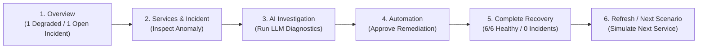

# HealthTechOps — Step-by-Step Live Interview Presentation Guide

> **How to Use This Guide:**  
> Keep this document open on your second monitor or phone while sharing your screen with the interviewer. It provides the **exact click-by-click actions**, **what to say in simple, confident English**, and **how to demonstrate the self-healing workflow repeatedly**.

---

## 🎯 The 45-Second Opening Pitch (Say This First)

> *"Thank you! Today I want to demonstrate **HealthTechOps**, an AI-powered Cloud Reliability and Autonomous SRE Platform built for healthcare microservices.*
>
> *In production healthcare platforms—like patient portals, digital pharmacies, and claims processing—a service degradation at 2 AM usually costs on-call engineers **1 to 2 hours** of manual log digging and troubleshooting to find the root cause.*
>
> *HealthTechOps automates this entire lifecycle: it detects metric anomalies in real-time, dispatches an autonomous local LLM to isolate root cause, and provides allowlist-guarded recovery runbooks with human-in-the-loop authorization.*
>
> *Right now on my screen, we have a live scenario where **only 1 of our 6 microservices is degraded**. I'll walk you through how we identify, triage, and automatically recover the system until **all 6 services are 100% healthy**."*

---

## 🖥️ Live Fire Drill: Step-by-Step Walkthrough

---

### Step 1: Operations Overview (Show the Degraded State)
* **What to Click:** Navigate to **Overview** (`/`).
* **What the Screen Shows:**
  * **Total Services:** `6 microservices`
  * **Healthy Services:** `5` (Amber alert)
  * **Open Incidents:** `1`
  * **System Health:** `DEGRADED`
  * **Recent Incident Stream:** Shows the active incident (e.g., `Pharmacy Service Elevated P95 Latency`).
* **What to Say:**
  > *"Here on the executive Operations Overview, we see real-time platform telemetry across our 6 healthcare microservices.*
  > 
  > *Notice that our system health is currently **DEGRADED**: exactly 5 services are healthy and **1 service has degraded**, generating 1 active high-severity incident.*
  > 
  > *In healthcare, if the Pharmacy Service latency spikes, patients cannot get prescriptions verified at pharmacy counters. Let's inspect the issue."*

---

### Step 2: Services Catalog & Incident Details
* **What to Click:** Click **Services** in the sidebar, then click **Incidents**.
* **What the Screen Shows:**
  * In **Services**: 5 green services, and **Pharmacy Service** highlighted in amber with elevated CPU (74.8%) and P95 latency (180.5ms).
  * In **Incidents**: Active incident `INC-001` with status `INVESTIGATING` and severity `HIGH`.
* **What to Say:**
  > *"In the Services catalog, we instantly see the degraded service without guessing. Latency has breached our 100ms SLO target, sitting at 180ms.*
  > 
  > *In the Incidents log, the platform has automatically correlated metrics and opened incident `INC-001`. Now let's trigger our Autonomous AI Triage engine."*

---

### Step 3: Autonomous AI Investigation & Root-Cause Synthesis
* **What to Click:** Click **AI Investigation** in the sidebar (or click the incident $\rightarrow$ "Launch AI Diagnosis").
* **What to Do:**
  1. Ensure the active incident is highlighted in the left queue.
  2. Click the **"Run AI Diagnostics"** button.
* **What the Screen Shows:**
  * The dark obsidian AI console streams the inference process.
  * **Model Confidence Score:** `94%`.
  * **Root Cause Diagnosis:** Clear explanation of sustained thread blockage in the connection pooling layer following a prescription batch dispatch.
  * **Telemetry Evidence:** 4 corroborating signals (latency elevated to 180ms, connection pool saturated at 98%, queue backlog, zero hardware faults).
  * **Recommended Remediation (Allowlist-Guarded):** Suggests `flush_connection_pool` and `restart_service`.
* **What to Do Next:** Click **"Queue for Review →"** next to `flush_connection_pool` (or `restart_service`).
  * A toast notification pops up: *"Action queued for human review in Automation queue"*.
* **What to Say:**
  > *"This is our AI Investigation Console, powered by local LLM inference. In seconds, the model correlates logs, metrics, and traces to diagnose the exact root cause: database connection pool saturation.*
  > 
  > *Crucially, in healthcare systems, you **never** let an AI autonomously execute commands on production databases without human oversight. The system enforces strict allowlists and queues the fix for human approval. Let's authorize it."*

---

### Step 4: Human-in-the-Loop Remediation Approval
* **What to Click:** Click **Automation & Runbooks** in the sidebar.
* **What the Screen Shows:**
  * Click on the **"Pending Approvals"** tab.
  * You will see the queued remediation action (`flush_connection_pool`, Risk: `LOW`, linked to `INC-001`).
* **What to Do:**
  * Click the green **"Approve"** button.
  * Toast notification: *"Remediation approved and executed — microservice recovered"*.
* **What to Say:**
  > *"Here in Automation & Runbooks, SREs have full human-in-the-loop control. High-risk actions require explicit role authorization.*
  > 
  > *I click **Approve**. The deterministic runbook executes, flushes the leaked connections, and verifies service recovery."*

---

### Step 5: The Full Recovery Reveal (All 6 Services Healthy)
* **What to Click:** Click **Overview** in the sidebar.
* **What the Screen Shows:**
  * **Total Services:** `6 microservices`
  * **Healthy Services:** `6` (**100% available** - Green checkmark)
  * **Open Incidents:** `0` (Zero critical)
  * **System Health:** `HEALTHY` (Green badge)
  * **Microservice Health:** `Healthy: 6 / 6` (100% green bar)
* **What to Say:**
  > *"And look at the Operations Overview now: **All 6 microservices are 100% healthy**, open incidents dropped to **0**, and system health is fully restored.*
  > 
  > *We resolved a critical production anomaly in under 2 minutes with zero guesswork, zero manual log filtering, and full compliance."*

---

### Step 6: Continuous Simulation & Rotating Scenarios (Demo Again on Refresh)
* **What to Say:**
  > *"The platform is completely dynamic. If another anomaly occurs, or if I refresh the page or click 'Simulate Degradation', the system simulates a different service failure."*
* **What to Do:**
  * Either **Refresh the page (F5)** OR click the **"Degrade Next Service"** button in the Overview header!
  * **Watch what happens:**
    * A different service immediately degrades (e.g. **Claims API** with CPU saturation, or **Provider Portal** with 502 errors)!
    * The Overview reflects 1 Degraded service again with a new incident.
    * You can show the interviewer that the workflow works across **any microservice in the cluster**!

---

## 📊 Summary of Rotating Failure Scenarios

| Scenario | Microservice | Root Cause | Recommended Runbook |
| :--- | :--- | :--- | :--- |
| **Scenario 1** | **Pharmacy Service** | Connection pool exhaustion & latency spike | `flush_connection_pool` / `restart_service` |
| **Scenario 2** | **Claims API** | Unbounded XML validation loop causing 88% CPU | `restart_service` / `scale_up` |
| **Scenario 3** | **Provider Portal** | Memory leak on roster sync causing 502 Bad Gateway | `restart_service` / `rollback_deployment` |
| **Scenario 4** | **Identity Service** | Redis session cache eviction miss storm | `clear_cache` / `restart_service` |

---

## 💡 Key Architectural Points to Highlight in the Interview

1. **Why Local LLM? (HIPAA & Security):**
   * Medical telemetry and diagnostic traces never leave the hospital boundary or get sent to third-party public clouds. Running Ollama locally guarantees HIPAA and zero data exfiltration compliance.
2. **Deterministic Runbooks vs LLM Hallucinations:**
   * The AI only selects from an allowlist of pre-verified, deterministic operational runbooks. It can never invent arbitrary bash scripts or destructive commands.
3. **Dual Standalone / Connected Execution:**
   * HealthTechOps runs both against live Docker microservices and as a standalone client-side simulation on Vercel with zero downtime.
