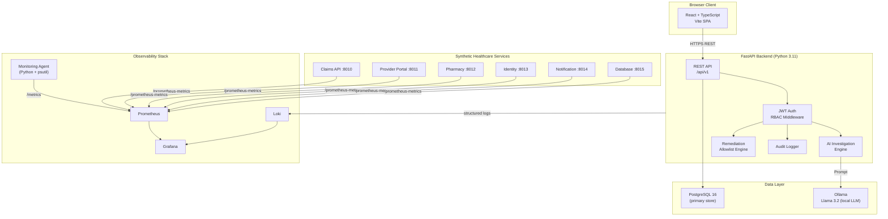
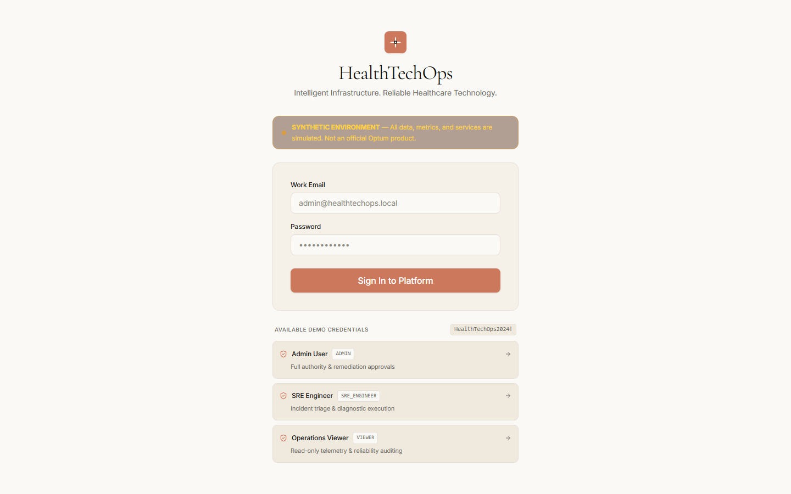
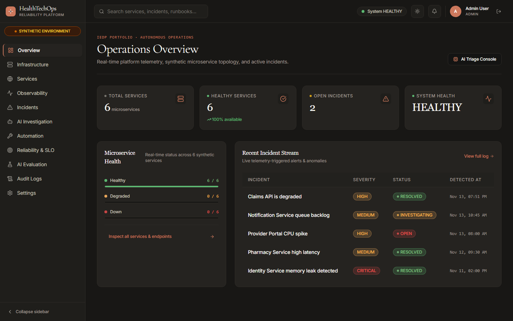
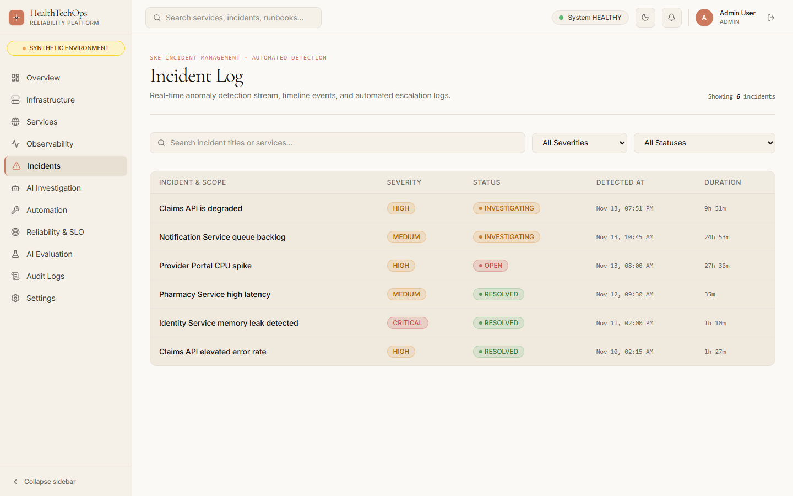
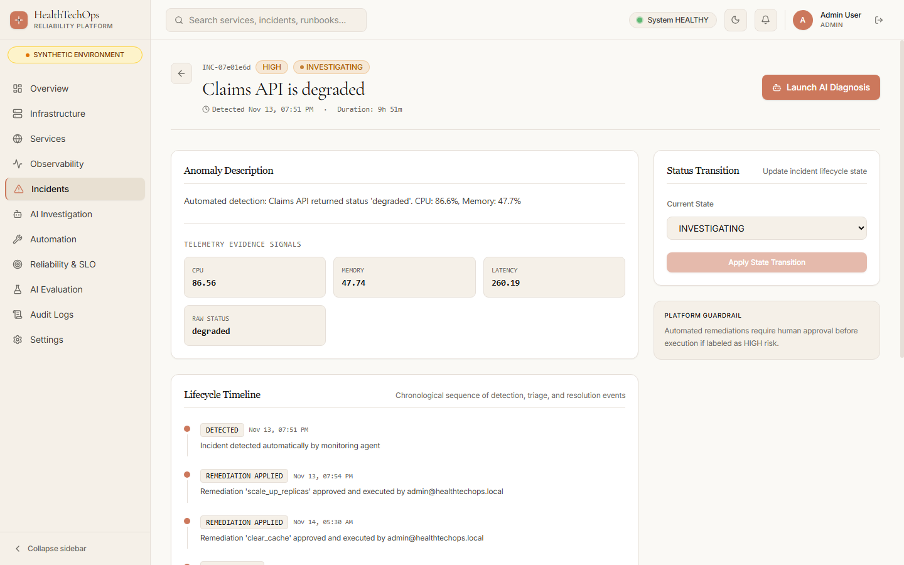
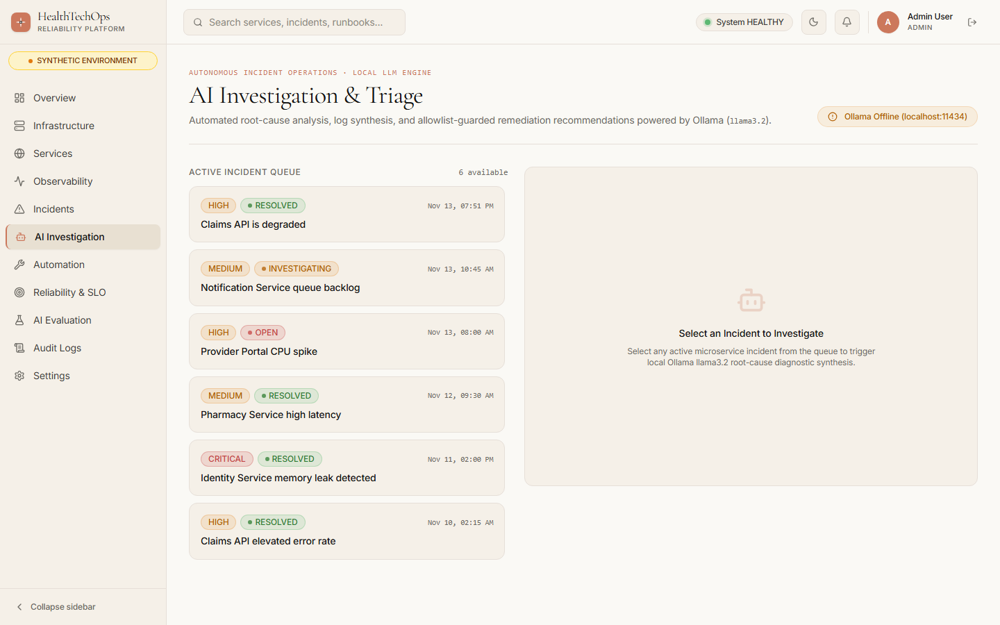
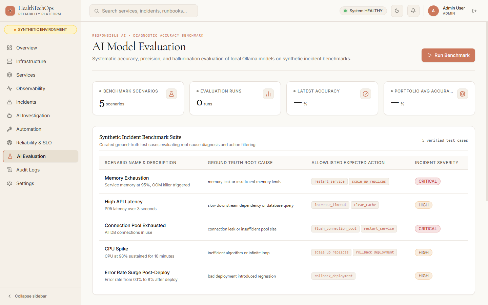
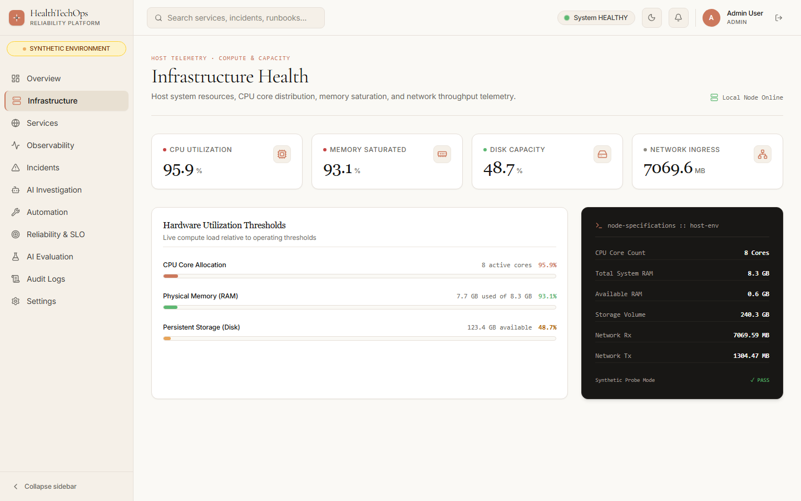
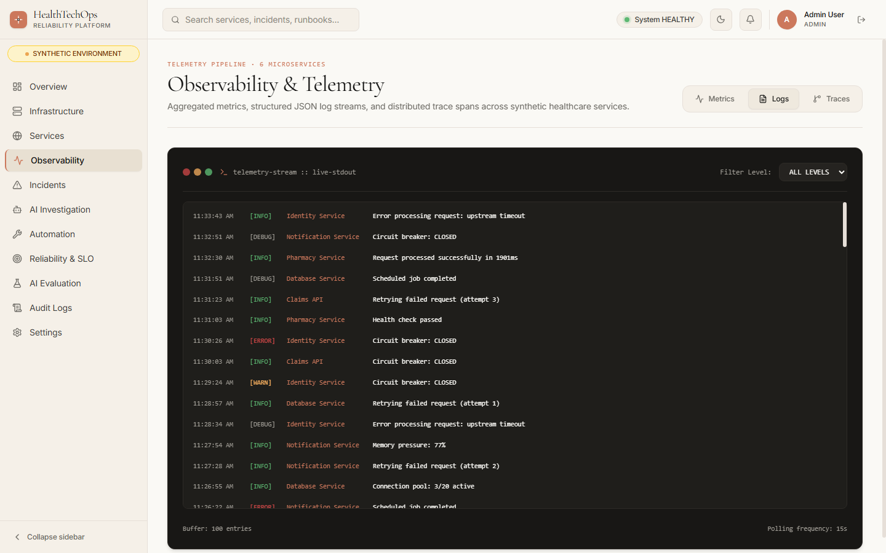

# HealthTechOps — AI-Powered Cloud Reliability & Incident Operations Platform

<div align="center">

[](https://health-tech-ops.vercel.app)
[](https://github.com/Jai-0709/HealthTechOps)
[](LICENSE)

**🌐 Live Web Application:** [https://health-tech-ops.vercel.app](https://health-tech-ops.vercel.app)  
**📂 GitHub Source Code:** [https://github.com/Jai-0709/HealthTechOps](https://github.com/Jai-0709/HealthTechOps)

</div>

> **Autonomous Cloud Reliability & AI Operations Platform** — Real-time infrastructure observability, synthetic healthcare microservice topology, and local LLM root-cause analysis with guardrailed human-in-the-loop remediation.

---

## Problem Statement

Modern healthcare technology organisations operate dozens of microservices under strict SLA requirements. When things go wrong — cascading failures, latency spikes, elevated error rates — on-call engineers face a firehose of alerts with limited tooling to quickly understand root cause and take safe, audited remediation actions.

**HealthTechOps** is an AIOps platform that closes this gap by combining real-time infrastructure observability with an AI-powered investigation layer backed by a local LLM (Ollama), providing explainable, role-gated, fully-audited remediation suggestions.

---

## Key Features

| # | Feature | Description |
|---|---------|-------------|
| 1 | **Real-time Observability** | Live CPU, memory, disk, and network metrics from a Python monitoring agent exposing Prometheus-compatible metrics |
| 2 | **Synthetic Service Simulation** | Six simulated healthcare microservices (Claims API, Provider Portal, Pharmacy, Identity, Notification, Database) with configurable failure modes |
| 3 | **Automated Incident Detection** | Rule-based threshold engine automatically opens incidents when metrics breach configurable SLOs |
| 4 | **AI-Powered Investigation** | Local Ollama LLM (Llama 3.2) analyses metric context and generates root-cause hypotheses with confidence scores |
| 5 | **Allowlist-Gated Remediation** | AI can only suggest actions from a pre-approved allowlist; all executions require human approval |
| 6 | **Role-Based Access Control** | ADMIN / SRE / ANALYST / VIEWER roles with fine-grained endpoint permissions |
| 7 | **Full Audit Trail** | Every user action, AI query, and remediation execution is immutably logged with actor, timestamp, and outcome |
| 8 | **SLO Tracking** | Per-service SLO definitions with error budget burn-rate tracking and reliability scoring |
| 9 | **Runbook Management** | Structured runbooks linked to incident types with step-by-step resolution guidance |
| 10 | **Grafana Integration** | Pre-provisioned Grafana dashboards pulling from Prometheus + Loki for log correlation |
| 11 | **Dark / Light Theme** | Full enterprise UI in React + TypeScript with Claude-inspired design system (cream canvas, coral accents) |

---

## Architecture



---

## Technology Stack

| Layer | Technology | Version |
|-------|-----------|---------|
| **Frontend** | React + TypeScript | 18 / 5.x |
| **Build Tool** | Vite | 5.x |
| **Styling** | Tailwind CSS v4 | 4.x |
| **State** | Zustand + TanStack Query | latest |
| **Charts** | Recharts | latest |
| **Backend** | FastAPI + Uvicorn | 0.115.x |
| **ORM** | SQLAlchemy 2 + Alembic | 2.x |
| **Database** | PostgreSQL | 16-alpine |
| **Auth** | python-jose + passlib | latest |
| **AI / LLM** | Ollama (Llama 3.2) | latest |
| **Metrics** | Prometheus + prometheus_client | latest |
| **Logs** | Grafana Loki | latest |
| **Dashboards** | Grafana OSS | latest |
| **CI** | GitHub Actions | — |
| **Containers** | Docker + Compose v2 | — |

---

## Prerequisites

| Tool | Minimum Version | Notes |
|------|----------------|-------|
| **Node.js** | 22 LTS | For frontend development |
| **Python** | 3.11 | For backend & monitoring agent |
| **Docker Desktop** | 4.x | For full-stack Docker mode |
| **Ollama** | latest | Install from [ollama.com](https://ollama.com) |
| **Git** | 2.x | — |

Install Ollama model:
```bash
ollama pull llama3.2
```

---

## Quick Start — Local Development (without Docker)

### One-Command Local Startup (Recommended)
```powershell
.\start_local.ps1
```
This launches all 4 services in separate windows:
1. FastAPI Backend (`http://localhost:8000`)
2. Synthetic Services Simulator (`http://localhost:8010-8015`)
3. Prometheus Monitoring Agent (`http://localhost:9100`)
4. Vite Frontend (`http://localhost:5173`)

### Or Manual Step-by-Step Setup

### 1. Configure environment
```powershell
Copy-Item .env.example .env
```

### 2. Backend setup
```powershell
Set-Location E:\HealthTechOps\backend
pip install -r requirements.txt
uvicorn app.main:app --reload --host 0.0.0.0 --port 8000
```

### 3. Frontend setup
```powershell
Set-Location E:\HealthTechOps\frontend
npm install
npm run dev
```

### 4. Start synthetic services
```powershell
Set-Location E:\HealthTechOps\synthetic-services
python simulator.py
```

### 5. Start monitoring agent
```powershell
Set-Location E:\HealthTechOps\monitoring
python agent.py
```

### 7. Access URLs

| Service | URL |
|---------|-----|
| **Live Cloud Deployment (Vercel)** | [https://health-tech-ops.vercel.app](https://health-tech-ops.vercel.app) |
| **GitHub Repository** | [https://github.com/Jai-0709/HealthTechOps](https://github.com/Jai-0709/HealthTechOps) |
| **Local Frontend** | http://localhost:5173 |
| **Backend API** | http://localhost:8000 |
| **API Docs** | http://localhost:8000/docs |
| **Metrics** | http://localhost:9100/metrics |
| **Claims API** | http://localhost:8010 |

---

## Docker Setup (Full Stack)

```bash
# Copy and configure environment
cp .env.example .env

# Build and start all services
docker compose up --build

# Or run in background
docker compose up -d --build
```

| Service | URL |
|---------|-----|
| **Frontend** | http://localhost:5173 |
| **Backend API** | http://localhost:8000 |
| **Grafana** | http://localhost:3001 (admin / healthtechops) |
| **Prometheus** | http://localhost:9090 |
| **Loki** | http://localhost:3100 |
| **PostgreSQL** | localhost:5432 |

---

## Environment Variables Reference

| Variable | Default | Description |
|----------|---------|-------------|
| `DATABASE_URL` | SQLite (local) | SQLAlchemy connection string |
| `JWT_SECRET_KEY` | *(must set)* | Secret for signing JWT tokens |
| `ACCESS_TOKEN_EXPIRE_MINUTES` | `30` | JWT token lifespan |
| `OLLAMA_HOST` | `http://localhost:11434` | Ollama API base URL |
| `OLLAMA_MODEL` | `llama3.2` | Model name to use |
| `MONITORING_INTERVAL_SECONDS` | `15` | How often the agent collects metrics |
| `CPU_HIGH_THRESHOLD` | `85` | CPU % that triggers HIGH alert |
| `CPU_CRITICAL_THRESHOLD` | `95` | CPU % that triggers CRITICAL alert |
| `VITE_API_BASE_URL` | `http://localhost:8000/api/v1` | Frontend → Backend API URL |
| `VITE_USE_MOCK` | `false` | Use mock data instead of real API |

See [.env.example](.env.example) for the complete list.

---

## Demo Credentials

> These are **synthetic credentials** for demonstration only. No real users exist.

| Role | Email | Password |
|------|-------|----------|
| **Admin** | admin@healthtechops.local | HealthTechOps2024! |
| **SRE** | sre@healthtechops.local | HealthTechOps2024! |
| **Analyst** | analyst@healthtechops.local | HealthTechOps2024! |
| **Viewer** | viewer@healthtechops.local | HealthTechOps2024! |

---

## Known Limitations

- **Local LLM only**: The AI investigation engine requires Ollama running locally. No cloud LLM API keys are used. Response quality depends on the local model.
- **Synthetic data**: All service metrics, incidents, and healthcare data are randomly generated. The platform is not suitable for real patient or clinical data.
- **Windows host volumes**: The Docker monitoring container mounts `/proc` and `/sys` which are Linux-specific; on Docker Desktop for Windows, host metrics inside the container reflect the Linux VM, not the Windows host.
- **No horizontal scaling**: This is a single-node demo. The backend is not designed for multi-replica deployment without shared session storage.
- **Loki retention**: Default Loki config retains logs indefinitely (no retention period set). Configure `retention_period` for production use.

---

## Screenshots

### System Health Overview (Light & Dark Theme)



### Incident Management & Root Cause Deep Dive



### AI Investigation Engine & Model Evaluation



### Infrastructure & Microservices Observability



---

## Project Structure

```
HealthTechOps/
├── backend/               # FastAPI application
│   ├── app/
│   │   ├── api/           # Route handlers
│   │   ├── models/        # SQLAlchemy models
│   │   ├── schemas/       # Pydantic schemas
│   │   ├── services/      # Business logic
│   │   └── main.py
│   ├── alembic/           # Database migrations
│   └── requirements.txt
├── frontend/              # React + TypeScript SPA
│   ├── src/
│   │   ├── api/           # API client + mock layer
│   │   ├── components/    # Reusable UI components
│   │   ├── pages/         # Route-level page components
│   │   ├── stores/        # Zustand state stores
│   │   └── types/         # TypeScript interfaces
│   └── package.json
├── monitoring/            # Python monitoring agent
├── synthetic-services/    # Simulated healthcare microservices
├── infrastructure/        # Docker, Prometheus, Grafana, Loki configs
│   ├── docker/            # Dockerfiles
│   ├── prometheus/        # prometheus.yml + alerts.yml
│   ├── grafana/           # Datasource + dashboard provisioning
│   └── loki/              # Loki config
├── docker-compose.yml
├── start_local.ps1        # One-command local development runner
├── run_demo.py            # CLI incident triage demonstration
├── .env.example
└── README.md
```

---

## Contributing

This is a personal portfolio project. Issues and suggestions are welcome via GitHub Issues.

## License

MIT License — see [LICENSE](LICENSE) for details.
